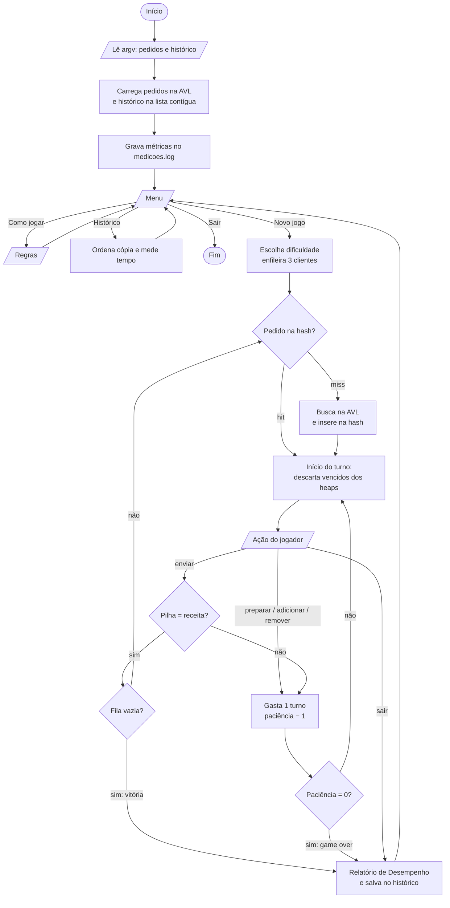

<div align="center">

# 🍔 Dado Burger

**Um jogo de hamburgueria por turnos, no terminal, feito para colocar em prática as estruturas de dados do semestre.**

*Trabalho Prático Final de Estruturas de Dados (INF01203) · UFRGS · Prof. Dennis Giovani Balreira · Turma C*

**Lucas Pires** · **Mateus Schenato**

</div>

---

## 📋 Sumário

- [Sobre o jogo](#-sobre-o-jogo)
- [Como compilar e executar](#-como-compilar-e-executar)
- [Como jogar](#-como-jogar)
- [Ingredientes](#-ingredientes)
- [Estruturas de dados](#-estruturas-de-dados)
- [Fluxo do programa](#-fluxo-do-programa)
- [Parâmetros do jogo](#%EF%B8%8F-parâmetros-do-jogo)
- [Medições de desempenho](#-medições-de-desempenho)
- [Arquivos de entrada](#-arquivos-de-entrada)
- [Organização do repositório](#-organização-do-repositório)
- [Equipe e uso de IA](#-equipe-e-uso-de-ia)

---

## 🎮 Sobre o jogo

Você é o mais novo funcionário do **Dado Burger**. Os clientes chegam em fila e cada um faz um pedido. Sua missão é montar cada hambúrguer **exatamente** como a receita manda, camada por camada, antes que a paciência do cliente acabe.

Por trás da chapa, tudo é estrutura de dados:

- os **837 mil pedidos** ficam numa **AVL**;
- os pedidos já sorteados ficam num **cache em tabela hash**;
- o hambúrguer é uma **pilha**;
- a receita é uma **lista encadeada**;
- os clientes esperam numa **fila**;
- carne, ovo e bacon vencem, então ficam em **heaps mínimos** ordenados pelo turno de validade;
- o histórico de partidas fica numa **lista contígua** e é ordenado com **Merge Sort** e **Quick Sort**.

> Nenhuma estrutura pronta da STL (`std::map`, `std::stack`, `std::queue`, `std::priority_queue`...) é usada. Todas partem dos códigos das aulas, convertidos de C para C++ e adaptados ao jogo.

---

## 🚀 Como compilar e executar

**Requisito:** `g++` com suporte a C++17 (por exemplo, MinGW no Windows).

Na **raiz do projeto**, compile com:

```sh
g++ src/main.cpp src/funcoes_menu.cpp src/jogo.cpp src/fila.cpp src/leitura_de_arquivos.cpp src/listacontest.cpp src/listaenc.cpp src/ingredientes.cpp src/avl.cpp src/hash.cpp src/timer.cpp src/sortings.cpp src/heap.cpp src/pilha.cpp src/hamburguer.cpp src/preparo.cpp src/medicoes.cpp -I src -o dado_burger.exe -Wall -std=c++17
```

Depois, execute passando o arquivo de **pedidos** e o de **histórico**:

```powershell
# PowerShell
.\dado_burger.exe data\pedidos.txt data\historico.txt
```

```bash
# Bash
./dado_burger.exe data/pedidos.txt data/historico.txt
```

| Argumento | Conteúdo |
|---|---|
| `argv[1]` | arquivo de pedidos (código + receita) |
| `argv[2]` | arquivo de histórico (nome + pontuação) |

> [!IMPORTANT]
> Execute **a partir da raiz do projeto**: o programa grava as métricas em `data/medicoes.log`.
> No dia da apresentação, basta trocar os caminhos pelos arquivos finais (`pedidos_final.txt` e `historico_final.txt`), sem mudar nenhuma linha de código.

> [!TIP]
> Rode num terminal de verdade (cmd ou Windows Terminal) para ver o hambúrguer colorido. Se o histórico ainda não existir, o jogo começa com o histórico vazio.

---

## 🕹️ Como jogar

No menu inicial há **Novo jogo**, **Como jogar**, **Histórico** e **Sair**. Ao começar uma partida, você escolhe a dificuldade e atende **3 clientes**, um de cada vez, na ordem de chegada.

### Ações da partida

| # | Ação | Gasta turno? |
|:-:|---|:-:|
| 1 | Adicionar um ingrediente ao hambúrguer | ✅ |
| 2 | Remover o ingrediente do topo (ele é descartado) | ✅ |
| 3 | Enviar o pedido para conferência | ✅ se estiver errado |
| 4 | Preparar carne, ovo ou bacon | ✅ |
| 5 | Preparar queijo, cebola ou tomate | ✅ |
| 6 | Consultar o estoque | ❌ |
| 7 | Encerrar a partida e salvar a pontuação | ❌ |

### Regras principais

- 🍞 O **pão de baixo** já começa no prato. Monte a receita de baixo para cima e feche com o **pão de cima** (`z`).
- 🚫 Não dá para colocar nada **em cima do pão de cima**. Se precisar, remova-o primeiro.
- ⏳ Só o **cliente da frente** perde paciência: 1 ponto a cada turno gasto.
- 🥩 Ingredientes perecíveis **vencem 3 turnos depois do preparo**. No início de cada turno, as unidades vencidas são descartadas, e ao usar um perecível sai sempre **o que vence primeiro**.
- 📦 Sem unidade no estoque (por exemplo, com o heap da carne vazio), o ingrediente **não pode ser adicionado**.
- ✅ **Vitória:** atender todos os clientes. 💀 **Game over:** a paciência do cliente da frente chegou a zero.

### Dificuldade e pontuação

A paciência inicial de cada cliente é o **número mínimo de turnos** para preparar e montar o pedido dele (incluindo o turno de envio) **mais uma margem**:

| Dificuldade | Margem de paciência | Multiplicador |
|---|:-:|:-:|
| 🟢 Fácil | +4 turnos | ×1 |
| 🟡 Normal | +2 turnos | ×1,5 |
| 🔴 Difícil | +0 turnos | ×2 |

Cada cliente atendido rende **10 × paciência restante × multiplicador**. No fim, você informa seu nome (até 20 caracteres) e a pontuação vai para o histórico.

---

## 🥬 Ingredientes

| Símbolo | Ingrediente | Preparo? | Perecível? | Onde fica o estoque |
|:-:|---|:-:|:-:|---|
| `z` | Pão de cima | — | — | ilimitado |
| `k` | Ketchup | — | — | ilimitado |
| `m` | Mostarda | — | — | ilimitado |
| `p` | Picles | — | — | ilimitado |
| `a` | Alface | — | — | ilimitado |
| `s` | Queijo suíço | ✅ | — | contador |
| `q` | Queijo cheddar | ✅ | — | contador |
| `c` | Cebola | ✅ | — | contador |
| `t` | Tomate | ✅ | — | contador |
| `n` | Carne | ✅ | ✅ 3 turnos | heap mínimo |
| `o` | Ovo frito | ✅ | ✅ 3 turnos | heap mínimo |
| `b` | Bacon | ✅ | ✅ 3 turnos | heap mínimo |

---

## 🧱 Estruturas de dados

| Papel no jogo | Estrutura | Arquivos |
|---|---|---|
| Armazenar e buscar os pedidos | **Árvore AVL** (chave = código do pedido) | `avl.hpp/.cpp` |
| Cache das buscas recentes | **Tabela hash** com encadeamento separado | `hash.hpp/.cpp` |
| Receita de cada pedido | **Lista encadeada** (um nó por ingrediente) | `listaenc.hpp/.cpp` |
| Montagem do hambúrguer | **Pilha** (LIFO) | `pilha.hpp/.cpp`, `hamburguer.cpp` |
| Clientes aguardando | **Fila** (FIFO) | `fila.hpp/.cpp` |
| Estoque de carne, ovo e bacon | **Heap mínimo** (chave = turno de vencimento), um por ingrediente | `heap.hpp/.cpp`, `preparo.cpp` |
| Histórico de partidas | **Lista contígua** alocada dinamicamente | `listacontest.hpp/.cpp` |
| Ordenação do histórico | **Merge Sort** (pontuação) e **Quick Sort** (nome) | `sortings.hpp/.cpp` |
| Medição de tempo | `timer` das aulas (`std::chrono`) | `timer.hpp/.cpp` |

<details>
<summary><b>Como as estruturas conversam entre si</b></summary>

1. **Sorteio do pedido:** o código é sorteado entre o menor e o maior código da AVL. A **hash** é consultada primeiro. Num *hit*, o pedido vem direto do cache. Num *miss*, a busca vai para a **AVL** (contando comparações e tempo) e o resultado entra no cache.
2. **Sem cópias desnecessárias:** a hash e cada cliente da fila guardam apenas um ponteiro (`const Pedido *`) para o pedido que está na AVL. A receita continua pertencendo à árvore.
3. **Conferência:** ao enviar, a **pilha** do hambúrguer, lida de baixo para cima, é comparada nó a nó com a **lista encadeada** da receita, sem destruir a pilha.
4. **Validade:** no início de cada turno, o topo de cada **heap** é verificado e removido enquanto estiver vencido.
5. **Histórico:** a ordenação acontece sobre uma **cópia** da lista. A cópia fica fora do tempo medido, e o arquivo original nunca é reordenado.

Todas as adaptações feitas nos códigos das aulas estão descritas, estrutura por estrutura, em [`ADAPTACOES.md`](ADAPTACOES.md).

</details>

---

## 🔀 Fluxo do programa



---

## ⚙️ Parâmetros do jogo

| Parâmetro | Valor | Onde mudar |
|---|---|---|
| Clientes por partida | 3 | `N_CLIENTES` em `src/jogo.cpp` |
| Paciência inicial | turnos mínimos do pedido + margem da dificuldade (4 / 2 / 0) | `src/jogo.cpp` |
| Validade dos perecíveis | 3 turnos (carne, ovo e bacon) | `src/ingredientes.hpp` |
| Tamanho da hash (`m`) | 11 | `src/main.cpp` |
| Função de hash | `h(k) = k mod m` | `src/hash.cpp` |
| Colisões | encadeamento separado | `src/hash.cpp` |
| Ordenação do histórico | Merge Sort (pontuação) e Quick Sort (nome) | `src/funcoes_menu.cpp` |

---

## 📊 Medições de desempenho

O programa grava tudo em `data/medicoes.log`, recriado a cada execução:

- **Após o carregamento:** nós inseridos na AVL, altura, rotações na inserção, tempo de carga e entradas do histórico.
- **Ao fim de cada partida:** Relatório de Desempenho com buscas na AVL (total, comparações, média e tempo), estatísticas da hash (hits, misses, taxa de acerto, fator de carga e colisões) e tempo da ordenação do histórico.

Exemplo real com `data/pedidos.txt` e `data/historico.txt`:

```text
=== MEDICOES APOS O CARREGAMENTO ===
-- AVL: carregamento --
Nos inseridos: 837253
Altura resultante: 20
Rotacoes (insercao): 837233
Tempo de carregamento: 2.521499 s
-- Historico: carregamento --
Entradas carregadas: 100041
====================================
```

> Com 837.253 nós, a altura mínima possível é ⌈log₂(n + 1)⌉ = 20, e o limite da AVL é ⌊1,44 log₂ n⌋ ≈ 28. A árvore ficou com a **altura ótima**. O tempo de carga varia de máquina para máquina.

---

## 📁 Arquivos de entrada

**Pedidos:** duas linhas por pedido, com o código e a receita (5 a 7 símbolos, de baixo para cima).

```text
1
pbtmcnz
2
nomosnz
```

**Histórico:** duas linhas por partida, com o nome e a pontuação.

```text
Mateus
45
```

A pasta `data/` também traz versões menores para testes: `pedidos_teste.txt`, `historico_teste.txt`, `historico_vazio.txt`, `hist_10k.txt` e `hist_50k.txt`.

---

## 🗂️ Organização do repositório

```text
jogo-ed/
├── src/                     # código do jogo (C++17)
│   ├── main.cpp             # ponto de entrada: carregamento, menu e laço principal
│   ├── jogo.cpp             # partida: fila de clientes, turnos, ações e pontuação
│   ├── funcoes_menu.cpp     # menu, "Como jogar", dificuldade e histórico
│   ├── hamburguer.cpp       # montagem, desenho e conferência do hambúrguer
│   ├── preparo.cpp          # preparo, estoque e validade dos ingredientes
│   ├── avl / hash / heap / pilha / fila / listaenc / listacontest
│   ├── sortings.cpp         # Merge Sort, Quick Sort (e o Radix testado antes)
│   ├── medicoes.cpp         # métricas e medicoes.log
│   ├── leitura_de_arquivos.cpp
│   ├── ingredientes.cpp     # tabela de ingredientes
│   └── timer.cpp            # medição de tempo das aulas
├── codigos-moodle/          # códigos originais das aulas (em C), usados como base
├── data/                    # pedidos, históricos e medicoes.log
├── tests/                   # testes auxiliares
├── ADAPTACOES.md            # registro de todas as adaptações feitas nas estruturas
└── USO_IA_*                 # declaração de uso de IA de cada integrante
```

---

## 👥 Equipe e uso de IA

| Integrante |
|---|
| **Lucas Pires** |
| **Mateus Schenato** |

Disciplina **INF01203 – Estruturas de Dados**, UFRGS, 2026/2, Turma C, Prof. **Dennis Giovani Balreira**.

Conforme a especificação do trabalho, todo uso de ferramentas de IA está declarado nos arquivos `USO_IA_*` da raiz e no relatório.

<div align="center">

---

*Feito com 🍔, ponteiros e muitas rotações de AVL.*

</div>
